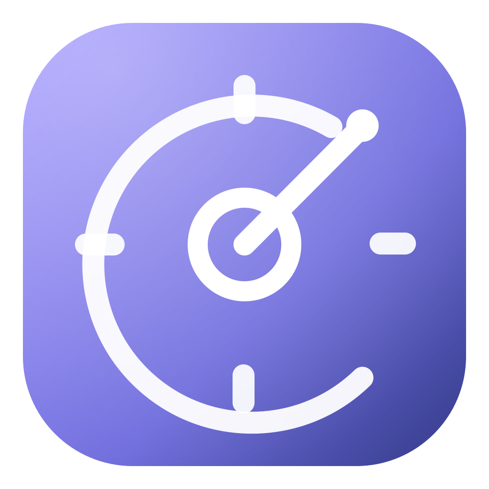
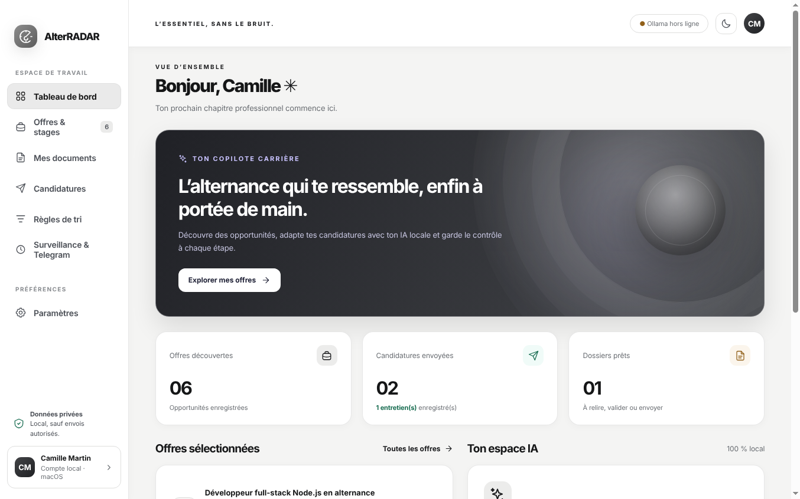
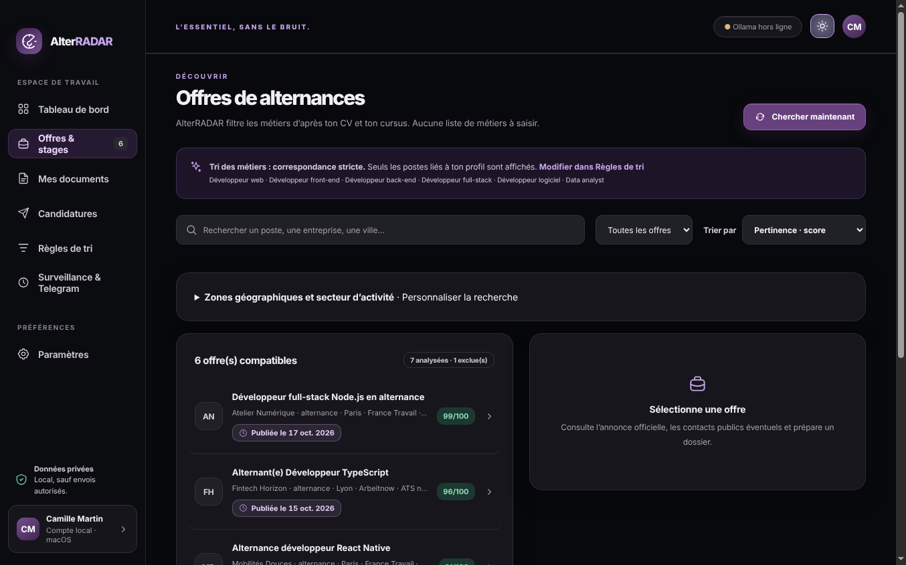
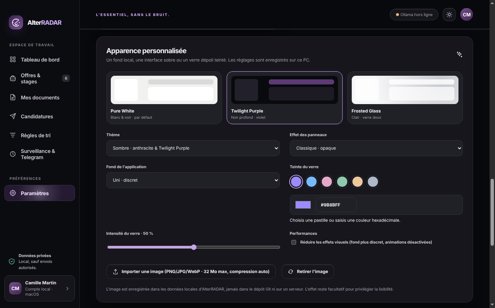

<div align="center">
  

  # AlterRADAR

  **L’alternance qui te ressemble, enfin à portée de main.**

  Application de bureau gratuite pour Windows et macOS qui cherche des **alternances et des stages**
  adaptés à ton CV, prépare des candidatures ciblées avec une IA locale et te laisse valider chaque envoi.

  [](https://github.com/AkshiiGIT/AlterRADAR/releases/latest)
  [](https://github.com/AkshiiGIT/AlterRADAR/actions/workflows/tests.yml)
  [](#installation)
  [](LICENSE)

  **[Télécharger](https://github.com/AkshiiGIT/AlterRADAR/releases/latest) · [Installation](INSTALLATION.md) · [Fonctionnalités](#fonctionnalités) · [Confidentialité](#confidentialité) · [Contribuer](#contribuer)**
</div>



## Pourquoi AlterRADAR ?

Chercher une alternance, c’est trier des centaines d’annonces hors sujet, réécrire son CV pour chaque offre et perdre le fil de ses candidatures. AlterRADAR regroupe ces étapes dans une seule application : tu importes ton CV, tu vérifies le profil détecté, puis l’application cherche et classe les offres selon tes compétences, ton niveau d’études et tes critères.

Tout reste sur ton ordinateur. Il n’y a pas de compte à créer, pas de serveur AlterRADAR et pas de télémétrie. L’IA est facultative et tourne en local avec [Ollama](https://ollama.com/).

## Fonctionnalités

| | |
|---|---|
| **Profil depuis le CV** | Extraction des informations utiles du CV (PDF, DOCX, TXT), à vérifier avant la recherche. |
| **Recherche multi-sources** | Sources publiques sans clé, plus France Travail, Adzuna, Jooble et La bonne alternance avec tes propres identifiants API. |
| **Recherche multi-zones** | Jusqu’à 12 villes, chacune avec son rayon (0–100 km), et un secteur d’activité au choix. |
| **Matching explicable** | Score indicatif, détection des métiers pertinents, suppression des doublons, règles de tri personnalisées et filtre de niveau Bac+N. |
| **Tri des offres** | Par pertinence, date de publication vérifiée ou distance approximative. |
| **Documents adaptés** | CV et lettre ciblés sur une page A4, export DOCX et PDF lisibles par les ATS. Toujours à relire avant envoi. |
| **Suivi des candidatures** | Statuts, historique et documents associés à chaque offre. |
| **IA locale Qwen / Ollama** | Choix d’un modèle adapté à la mémoire de ton ordinateur. Aucun téléchargement sans ton accord. |
| **Telegram (facultatif)** | Alertes et validation des dossiers depuis ton téléphone, via ton propre bot. |
| **Surveillance en arrière-plan** | Nouvelle recherche toutes les 5 minutes depuis la zone de notification (Windows) ou la barre des menus (macOS). |
| **Apparence** | Thème clair Pure White, thème sombre Twilight Purple, verre dépoli, fonds d’écran locaux. |

| Offres compatibles (thème Twilight Purple) | Apparence personnalisée |
|:---:|:---:|
|  |  |

*Captures réalisées avec un profil fictif.*

## Installation

Télécharge la dernière version sur la page **[Releases](https://github.com/AkshiiGIT/AlterRADAR/releases/latest)**. Node.js n’est pas nécessaire.

| Ton ordinateur | Fichier à télécharger |
|---|---|
| Windows 10 ou 11 (la plupart des PC) | `AlterRADAR-x.y.z-Windows-x64-Setup.exe` (installation) ou `…-Windows-x64-Portable.exe` (sans installation) |
| Windows sur processeur ARM (Snapdragon) | `AlterRADAR-x.y.z-Windows-arm64-Setup.exe` |
| Mac avec puce Apple (M1, M2, M3, M4…) | `AlterRADAR-x.y.z-macOS-arm64.dmg` |
| Mac avec processeur Intel | `AlterRADAR-x.y.z-macOS-x64.dmg` |

Pour savoir quel Mac tu as : menu Apple → **À propos de ce Mac** (« Puce Apple » ou « Processeur Intel »). Sous Windows : **Paramètres → Système → Informations système → Type du système**.

> [!NOTE]
> Les installateurs ne sont pas signés avec un certificat payant. Au premier lancement, Windows SmartScreen ou macOS Gatekeeper affichent un avertissement. La marche à suivre est détaillée dans le **[guide d’installation](INSTALLATION.md)**. Vérifie toujours que le fichier vient de cette page Releases (sommes de contrôle dans `SHA256SUMS.txt`).

Pour l’IA, installe ensuite [Ollama](https://ollama.com/download) puis choisis un modèle dans **Paramètres → Modèle IA local**. La recherche d’offres fonctionne sans Ollama.

## Comment ça marche ?

1. **Importe ton CV** et, si tu en as une, une ancienne lettre de motivation.
2. **Vérifie ton profil** : formation, niveau Bac+N, compétences et métiers proposés.
3. **Explore les offres** compatibles, ajuste les règles et ouvre les annonces d’origine.
4. **Prépare tes candidatures** : CV et lettre adaptés, brouillon d’e-mail avec pièces jointes, suivi des étapes.
5. **Active les options avancées si tu veux** : surveillance, Telegram, envoi SMTP après validation.

## Sources d’offres

Sans aucune configuration, AlterRADAR interroge sept sources publiques (dont une liste communautaire d’alternances tech en France). **France Travail**, **Adzuna** et **Jooble** demandent des identifiants gratuits à saisir dans **Surveillance & Telegram**. **La bonne alternance** fonctionne avec une clé personnelle ; le [relais Cloudflare](relay/README.md) fourni dans le dépôt n’est pas déployé par défaut.

AlterRADAR reconnaît aussi 30 logiciels de recrutement (ATS) à partir du lien des annonces et peut parcourir 9 tableaux d’offres publics. Reconnaître un ATS ne permet pas de déposer une candidature automatiquement : les formulaires externes restent à remplir à la main. Détails dans la [matrice ATS](docs/ATS.md).

Les sources ne garantissent ni l’exhaustivité ni la fraîcheur des annonces. Pour tester les sources sans clé depuis ta connexion : `npm run diagnose:sources`.

## Confidentialité

Le profil, les textes extraits des documents, les offres et le suivi sont enregistrés **sur ton ordinateur** :

| Système | Dossier des données |
|---|---|
| Windows | `%APPDATA%\AlterRADAR` |
| macOS | `~/Library/Application Support/AlterRADAR` |

Les demandes d’IA vont uniquement à Ollama sur ton ordinateur (`127.0.0.1`). La recherche d’offres contacte les plateformes d’emploi **sans leur envoyer ton CV**. Si tu actives Telegram, les alertes et éventuellement tes documents passent par les serveurs Telegram, qui ne chiffrent pas les conversations de bots de bout en bout. Les jetons Telegram, mots de passe SMTP et clés API sont chiffrés avec le trousseau du système (Windows DPAPI, trousseau macOS) ; le reste des données locales n’est pas chiffré au repos.

Détails : [politique de confidentialité](docs/PRIVACY.md) · [configuration Telegram](docs/TELEGRAM.md).

## Lancer depuis le code source

Il faut [Node.js](https://nodejs.org/) 24 LTS et Git.

```bash
git clone https://github.com/AkshiiGIT/AlterRADAR.git
cd AlterRADAR
npm ci
npm start
```

Sans terminal, double-clique sur `Lancer-AlterRADAR.bat` (Windows) ou `Lancer-AlterRADAR.command` (macOS) : ils installent les dépendances au premier lancement. Node.js reste nécessaire dans ce mode.

## Développement

```bash
npm test             # tests unitaires
npm run smoke:deps   # génération réelle DOCX, PDF et e-mail
npm run self-test    # lance Electron sans fenêtre et vérifie documents, PDF et interface
npm run dist:win     # installateurs Windows (sur Windows)
npm run dist:mac     # .dmg et .zip macOS (sur un Mac)
```

À chaque push, GitHub Actions exécute les tests sur Windows et macOS. Un tag `v*` construit les installateurs, lance chaque application en mode autotest sur les deux systèmes et prépare une Release en **brouillon**, à publier manuellement après vérification. La procédure complète est dans [docs/PUBLICATION_GITHUB.md](docs/PUBLICATION_GITHUB.md).

## Limites connues

- Les installateurs ne sont ni signés par un certificat Windows ni notarisés par Apple (voir [INSTALLATION.md](INSTALLATION.md)).
- Les tests automatisés valident la logique avec des données simulées. Ils ne garantissent pas que toutes les API externes répondent ni que chaque connecteur ATS fonctionne avec chaque entreprise.
- Le CV, les offres et les documents proposés par l’IA doivent être relus avant tout envoi.
- La mise en page DOCX sur une page peut légèrement varier selon la version de Word et les polices installées : vérifie l’export avant envoi.

## Contribuer

Les signalements de bugs et propositions sont bienvenus dans les [Issues](https://github.com/AkshiiGIT/AlterRADAR/issues). Indique ton système (Windows ou macOS, version) et la version d’AlterRADAR. Pour une modification importante, ouvre d’abord une issue pour en discuter.

**Ne partage jamais de CV, de jeton Telegram, de mot de passe SMTP ni de clé API dans une issue ou un commit.** Pour une faille de sécurité, suis la [politique de sécurité](SECURITY.md).

## Créateur

Créé et développé par **Akasche MAHINTAN** · [GitHub](https://github.com/AkshiiGIT) · [LinkedIn](https://www.linkedin.com/in/akasche-mahintan) · [Contact](mailto:akasche.pro@gmail.com)

## Licence

AlterRADAR est gratuit et open source, distribué sous licence [MIT](LICENSE). Historique des versions : [CHANGELOG.md](CHANGELOG.md).

<div align="center">
  <sub>© 2026 Akasche MAHINTAN · AlterRADAR — L’essentiel, sans le bruit.</sub>
</div>
